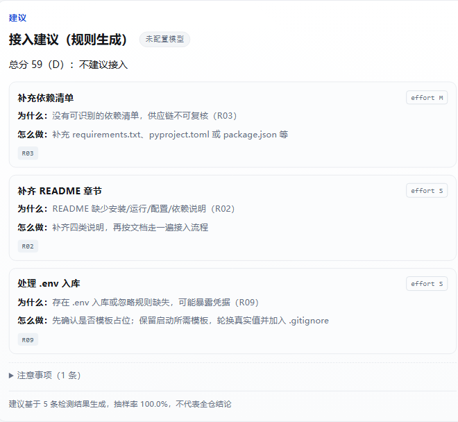
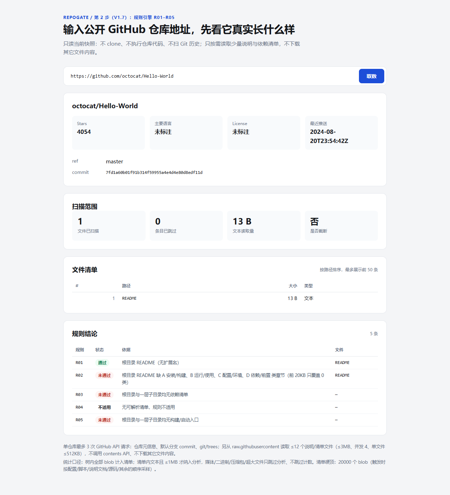

# RepoGate

RepoGate 面向企业 Windows 内网团队，输入一个公开 GitHub 仓库地址，输出 0-100 分、A/B/C/D 等级、一句话准入裁决、主要风险和可执行整改建议。

它解决的不是“这个仓库有没有漏洞”，而是更接近采购与工程评审现场的问题：

> **这个仓库今天能不能进我们的内网？如果不能，先改哪三件事？这个结论凭什么可复核？**

仓库：<https://github.com/klxlx/repogate> · 引擎 `repogate-3.2` · 14 条规则 · MIT License


```powershell
git clone https://github.com/klxlx/repogate.git
cd repogate
python -m venv .venv
.venv\Scripts\python.exe -m pip install -r requirements.txt
.venv\Scripts\python.exe -m uvicorn app.main:app --reload
```

打开 <http://127.0.0.1:8000>。不配置模型也能完整使用；配置 `LLM_BASE_URL` / `LLM_API_KEY` / `LLM_MODEL` 后，报告页会多一张真实模型生成的建议卡。没有模型时页面明确标注“规则生成”，不把 fallback 伪装成 AI。

## 一分钟验收

如果面试官只想快速判断这份作业有没有真的跑通，可以按下面这张表看。代码位置、页面证据和测试证据都直接对应回题目要求。

| 题目要求 | 现在的实现 | 直接看哪里 |
| --- | --- | --- |
| Web 页面输入公开 Git 仓库地址 | 首页校验 URL，真实拉取 GitHub 元信息与 commit | `app/main.py`、`app/github.py`、首页截图 |
| 检查 README、依赖清单、启动入口 | R01-R05 分别判断文档、依赖、lockfile 与启动入口 | `app/rules/docs.py`、`app/rules/deps.py` |
| 识别 Windows 专用脚本 | R06/R07 识别 `.bat/.cmd/.ps1/.vbs`，并区分“有 Windows 入口”和“缺跨平台入口” | `app/rules/portability.py` |
| 识别硬编码路径 | R08 检查盘符、UNC 和本机绝对路径，单规则扣分封顶 | `app/rules/portability.py`、`tests/test_portability.py` |
| 识别密钥与敏感信息 | R09-R11 检查 `.env`、私钥材料、常见令牌；证据统一掩码 | `app/rules/secrets.py`、`app/masking.py` |
| 可视化展示评分和风险清单 | 报告页展示总分、等级、裁决、五维扣分、14 条检查矩阵与风险证据 | `app/templates/index.html`、`docs/screenshot-report.png` |
| 结合 AI 给出评分和接入建议 | AI 只解释结构化事实，不参与确定性评分；无模型、超时、坏 JSON 均回退规则建议 | `app/advice.py`、`docs/screenshot-ai-deepseek.png` |
| 更新跟踪设计 | 以 commit 为缓存边界；支持 atom HEAD、API 回退、限流 stale 报告 | `app/github.py`、`app/cache.py`、下文“更新跟踪” |
| AI 使用与自我纠错记录 | 记录工具、验证方式、AI 建议删除 `.env`、编造 R99 等问题及拦截机制 | `AI_USAGE.md` |
| 核心功能可运行 | `174 passed, 1 skipped`，六仓 golden、桌面与移动端页面验收均有记录 | 本文“验收证据” |

最短复现路径是输入 `https://github.com/octocat/Hello-World`，会得到一份可完整展示检查矩阵和风险证据的 `59 / D / 不建议接入` 报告。若想看更接近真实工程的结论，可再扫描 `https://github.com/psf/requests` 或 `https://github.com/gitleaks/gitleaks`。

## 复盘：为什么我没有把它做成通用扫描器

题目同时要求 README、依赖、Windows 脚本、硬编码路径、密钥、评分、风险清单、AI 建议和更新跟踪。48 小时内把这些都做成“能检测”并不难，难的是最后给出一份别人敢拿去开评审会的结论。

我最先遇到的是边界问题。公开仓库不能随便 clone，更不能为了判断安全性去执行安装脚本；GitHub API 有匿名配额；一次扫描也不可能把超大仓库和历史提交全部读完。如果假装这些都覆盖了，工具看起来功能很多，实际却会把不确定性藏起来。

所以我把产品收窄成一个明确的决策工具：**只读公开仓库的当前快照，不 clone、不执行代码、不扫 Git 历史、不做 CVE 审计**。这个边界让扫描可重复、可解释，也让报告里的“已扫描”和“未覆盖”可以分开说。

另一个约束是用户。题目没有规定行业，我选择把目标用户定义为 Windows 内网里的工程与运维人员，而不是安全研究团队。对他们来说，一份报告最重要的是三件事：

- 哪些问题会直接阻断接入；
- 每条判断对应哪个文件、哪条规则；
- 如果今天不能接，先改什么、改完怎么复验。

这比堆更多扫描规则更接近真实使用场景，也解释了为什么报告第一屏是“等级、裁决和风险”，而不是一长串原始告警。

## 一次扫描是怎么走完的

```text
仓库 URL
  -> 校验地址并解析默认分支
  -> 解析目标 commit，确认本次到底扫的是哪一版
  -> 通过 GitHub tree 获取当前清单
  -> 按规则需要读取文本快照，控制文件数、字节数与超时
  -> 14 条规则产生 pass / fail / degraded / n/a 和证据
  -> 五维扣分、严重度扣分、封顶、等级与裁决
  -> 页面展示结论、证据、风险、建议与缓存状态
  -> 以 owner/repo + commit + engine_version 缓存报告
```

这里没有“下载整个仓库”这一步，是主动取舍。它换来了速度和可预测的只读边界，代价是大仓库只能抽样，Git 历史、二进制文件、安装脚本行为和 CVE 不在结论范围内。页面会显示扫描文件数、字节数、抽样率和是否截断；低抽样只作为提示，不会偷偷把结论说成全仓已经验证。

所有敏感证据在进入响应、页面和 golden 文件前都会经过掩码。完整密钥既不进入报告，也不进入日志。

## 评分为什么这样分

如果只有 14 条规则和一张风险表，用户仍然要自己判断“到底能不能接”。所以规则之上还需要一层稳定的评分契约：同样的输入必须得到同样的分数，模型不能改变结论。

| 维度 | 权重 | 对应规则 | 为什么这样定 |
| --- | ---: | --- | --- |
| 密钥与敏感信息 | 30 | R09 / R10 / R11 | 这是最可能直接阻断内网接入的风险 |
| 平台可移植 | 25 | R06 / R07 / R08 | 目标用户是 Windows 团队，路径和脚本问题会直接影响落地 |
| 文档完备 | 20 | R01 / R02 | 没有可读文档，后续维护成本会转嫁给接入团队 |
| 依赖与入口 | 15 | R03 / R04 / R05 | 决定项目能否被安装、启动和复现 |
| 维护状态 | 10 | R12 / R13 / R14 | 重要，但不应该仅凭仓库变旧就阻断一次试用 |

维度分 = `max(0, 权重 - 该维度 finding 扣分合计)`，`raw_total` 为五维之和，最后按门槛表取最严上限。

R01-R08 使用规则定义的固定分值；R09-R14 按严重度扣分：

| severity | critical | high | medium | low | info |
| --- | ---: | ---: | ---: | ---: | ---: |
| 扣分 | -30 | -15 | -10 | -3 | 0 |

只有严重度不够，还需要阻断条件。否则一个真实私钥泄漏可能被其他维度的高分“平均掉”。当前封顶规则如下：

| 触发条件 | 总分上限 | 等级 |
| --- | ---: | --- |
| R10 / R11 存在 `critical` 且 `cap_eligible=true` | 59 | D |
| R09 存在 `critical`，即真实值入库 | 69 | C |
| R09 存在 `medium`，即占位值或 `.env` 被提交 | 79 | B |
| `docs + deps` 维度扣分合计 >= 12 | 59 | D |
| `docs + deps` 维度扣分合计 8-11 | 69 | C |

等级与裁决保持单一映射：`>=85 A 可直接接入`、`70-84 B 小修后接入`、`60-69 C 需整改`、`<60 D 不建议接入`。

我特意没有给 R07“缺跨平台入口”设置封顶。目标场景本来就是 Windows，缺 `.sh` 是迁移成本，不是阻断项。这是产品判断，不能为了让评分看起来更严格就把它升级为事故。

## 14 条规则

| id | 维度 | 判定 | 分值 | 实现 |
| --- | --- | --- | ---: | --- |
| R01 | docs | 最高可用层级没有 README | -10 | `app/rules/docs.py` |
| R02 | docs | README 前 20KB 覆盖少于 2 类安装/运行/配置/依赖信息 | -4 | `app/rules/docs.py` |
| R03 | deps | 最高可用层级没有依赖清单 | -8 | `app/rules/deps.py` |
| R04 | deps | 没有 lockfile 且浮动版本超过 50% | -2 | `app/rules/deps.py` |
| R05 | deps | 没有构建或启动入口 | -4 | `app/rules/deps.py` |
| R06 | portability | Windows 专用脚本数量与占比达到阈值 | -6 | `app/rules/portability.py` |
| R07 | portability | 有 Windows 脚本但缺少跨平台入口 | -4 | `app/rules/portability.py` |
| R08 | portability | 硬编码盘符、UNC 或本机绝对路径，单规则封顶 -10 | -10 | `app/rules/portability.py` |
| R09 | secrets | `.env` 入库；真实值、占位值和仅缺 `.gitignore` 分级处理 | -10 | `app/rules/secrets.py` |
| R10 | secrets | 私钥材料；内容命中或仅文件名命中分级处理 | -15 | `app/rules/secrets.py` |
| R11 | secrets | OpenAI/AWS/GitHub/Slack/Google/JWT/Bearer/账密 URL 等令牌形态 | -15 | `app/rules/secrets.py` |
| R12 | maintenance | 根目录没有 LICENSE 且 GitHub 元信息可判定 | -3 | `app/rules/maintenance.py` |
| R13 | maintenance | `pushed_at` 距今超过 365 天 | -3 | `app/rules/maintenance.py` |
| R14 | maintenance | 仓库已归档 | -3 | `app/rules/maintenance.py` |

规则统一返回 `pass / fail / degraded / n/a` 四态，`GET /api/rules` 返回注册表，页面、API 和测试使用同一份定义，避免“页面说一套、接口算另一套”。

## 更新跟踪：缓存不能假装自己是最新报告

接入审查一旦被分享出去，最危险的不是慢，而是旧结论被误认为当前 commit 的结论。因此缓存边界必须是 commit，而不是仓库名。

缓存 key 是 `owner/repo@commit_sha@engine_version`，文件写在：

```text
.cache/reports/<owner>__<repo>/<engine_version>__<sha>.json
```

每次打开报告，先解析上游默认分支的 HEAD，再决定是否命中缓存。HEAD 优先走不消耗 GitHub API 配额的 atom 路径；atom 404 或解析失败时回退元信息，再试 atom。缓存命中后不再拉 tree、不再读文件内容。原子写使用临时文件加 `os.replace`，避免中断时留下半份 JSON。

引擎升级后，旧缓存不能被算作新引擎的 hit。限流时也不能为了页面好看伪造 `hit=true`。报告页会明确显示 commit、扫描时间、引擎版本、缓存状态与缓存时间。

| 现场情况 | 系统行为 | 用户能看到什么 |
| --- | --- | --- |
| commit 和引擎版本一致，缓存命中 | 直接复用报告，不重扫文件 | `cache.hit=true`、缓存时间、原 commit |
| atom 不可达 | 回退到 GitHub commits API 获取 SHA | 真实请求次数，不宣称“永远零 API” |
| 限流但存在任意缓存 | 返回 HTTP 200 的旧报告 | `cache.stale=true`、黄条提示、旧 commit |
| 限流且没有缓存 | 返回 429 | 错误码、恢复建议、`retry_after` |
| 引擎版本发生变化 | 不把旧缓存算 hit | 当前引擎版本与缓存来源分别展示 |

这里有一个刻意的限制：没有 webhook、没有定时轮询，也不会用 `pushed_at` 猜测最新 commit。当前版本只在用户打开报告时解析 HEAD。这样适合单机内部工具的最小闭环；如果要做持续监控，下一步应当加 webhook 或定时任务，而不是把“打开时检查”包装成实时监控。

## AI 建议为什么不能参与评分

模型擅长把结构化风险写成人能读懂的动作，不擅长保证同一份输入永远得到同一个分数。一次扫描里如果让模型读完整仓库再打分，报告会更容易“像 AI”，却更难复核、复现和追责。

所以这里把职责拆开：

- 确定性部分由规则和评分引擎完成，模型无权改总分、等级和封顶；
- 模型只读取白名单结构化事实，例如风险项、规则 id、文件路径和整改方向；
- 输出必须通过 JSON schema、字段长度和 `rule_ids` 白名单校验；
- 模型超时、无密钥、坏 JSON 或引用不存在规则时，返回规则 fallback，并明确写 `fallback_reason`；
- 完整密钥不进入模型上下文，模型也不能看到未掩码证据。

没有配置模型并不是失败状态。页面仍然给出规则生成的可执行建议，只是角标会明确说“未配置模型”，不会冒充真实 AI 输出。

真实模型使用 DeepSeek `deepseek-flash` 跑通过 `/api/advice`，多次调用耗时约 2.2-2.9 秒、约 1.4k tokens。原始响应见 `docs/real-model-advice.json`。DeepSeek V4 默认可能把预算全部用进 `reasoning_content` 导致 `content` 为空，因此只对显式配置或 DeepSeek 端点关闭 thinking，其他 OpenAI 兼容端点不受影响。

AI 的失败案例、验证方式和最终拦截机制不在 README 里重复叙事，单独放在 [AI_USAGE.md](AI_USAGE.md)。这份记录的重点不是“AI 帮了多少”，而是“哪些地方最终由人、规则或服务端说了算”。

## 页面与失败态

报告页按“先给结论，再给证据”的顺序组织：顶部是总分、等级、裁决和一句话建议；下面展开五维扣分、14 条检查矩阵、风险证据、规则/AI 建议与缓存状态。

桌面报告页和 375px 版本：


真实模型建议与无模型 fallback：




首页不是空白输入框，直接给出三个示例仓库；非法 URL 在前端就会被拦住。网络断开、429 和超时都不是白屏：




`GET /?repo=<仓库地址>` 可以直接打开同一份报告，便于把结论原样发给同事。“重新扫描”等价于 `refresh=1`，会跳过缓存并消耗一次 GitHub API 配额。

## 验收证据

当前测试在 Python 3.13.18 上运行：

```powershell
.venv\Scripts\python.exe -m pytest -q
```

结果：`174 passed, 1 skipped`。跳过项是默认不联网的 golden；设置 `REPOGATE_GOLDEN_NETWORK=1` 可执行联网回归。

六仓 3.2 实扫结果：

| 仓库 | 结果 | 原始记录 |
| --- | --- | --- |
| `octocat/Hello-World` | 59 / D | `docs/six-repos-3.2.md` |
| `psf/requests` | 95 / A | `docs/six-repos-3.2.md` |
| `microsoft/PowerToys` | 84 / B | `docs/six-repos-3.2.md` |
| `microsoft/vscode` | 91 / A | `docs/six-repos-3.2.md` |
| `gitleaks/gitleaks` | 98 / A | `docs/six-repos-3.2.md` |
| `fastapi/full-stack-fastapi-template` | 73 / B | `docs/six-repos-3.2.md` |

自扫描 `klxlx/repogate` 得到 `94 A`，原始响应见 `docs/self-scan.json`。其中 R08 的最高等级命中来自 `app/rules/portability.py:33` 中的 `C:\foo` 规则示例文本，不是真实硬编码路径。这是规则自身的已知误报，不能因为分数好看就删掉证据。R08 仍是启发式规则，后续若修复应补“规则定义文本豁免”和对照测试，而不是调权重掩盖。

页面验收记录：

- 首页 HTTP 200，示例按钮、输入框和非法 URL 拦截正常；
- `octocat/Hello-World` 实扫得到 `59 / D / 不建议接入`，14 条检查矩阵、5 条风险、commit 与规则 fallback 均可见；
- 缓存复跑为 `hit=true, stale=false`；
- 1280px 与 375px 均无横向溢出或文字越界；
- 业务页面无 JavaScript 异常，只有站点 favicon 404，不影响功能。

## 已知限制

- **大仓库只做抽样**：R08/R10/R11 受文本读取上限约束，页面和 JSON 必须显示抽样率；低抽样不能被解释成全仓安全。
- **R08 仍会误报和漏报**：小写 `c:\` 已补测试，但规则自身示例路径仍可能被识别为硬编码；`s:\next` 这类转义前缀写法也可能漏。修复应继续补测试，不能靠调权重。
- **测试目录里的敏感命中只提示**：`tests/`、`fixtures/`、`docs/` 等目录中的假密钥不应被当成事故，但真实泄露放在这些目录时可能被低估。
- **R11 规则定义豁免依赖关键字**：路径、文件名或正则上下文不满足豁免条件时，规则定义本身可能被误判。
- **没有真实并发压测**：当前验证的是单进程、单仓库扫描与缓存热命中，不代表多用户或超大仓库并发下的延迟和内存上限。
- **不覆盖 CVE、Git 历史、二进制和恶意安装行为**：这些需要不同的数据源和执行隔离，不能靠当前只读快照扫描器补齐。
- **atom 不可达时会产生 API 请求**：正常网络下缓存命中可走零配额 atom；当前网络曾出现 atom 连接超时，实际回退到 `meta + commits`，因此不宣称缓存命中永远 0 API。
- **AI 建议不是审计结论**：模型输出经过校验和 fallback，但仍可能遗漏上下文；最终接入决定需要人复核。

## 如果继续往前走

下一步最有价值的不是继续增加规则，而是让这份报告进入真实协作流程：

- 用 webhook 或定时任务发现新 commit，并保留同一仓库的版本对比；
- 支持同一组织下 5-20 个候选仓库并排比较，直接给出接入顺序；
- 按业务线聚合 A/B/C/D 分布、常见阻断项和缓存命中率；
- 在多人使用前补权限、审计日志和并发压测。

当前版本先保证单机能跑、结论可追、AI 失败不冒充成功。这比在 48 小时内塞进一个没有验证过的组织看板更符合现阶段约束。

## API

| 入口 | 说明 |
| --- | --- |
| `GET /api/inspect?repo=<url>&refresh=0\|1` | 查询参数版；`refresh=1` 跳过缓存 |
| `POST /api/inspect` | JSON `{"repo_url":"https://github.com/owner/repo"}`，兼容 `url` 字段 |
| `POST /api/advice` | JSON `{"repo":"...","refresh":0}`；无模型也返回 200 规则 fallback |
| `GET /api/health` | 返回 `engine_version / schema_version / rules_count` |
| `GET /api/rules` | 返回 14 条规则注册表 |
| `GET /docs` / `GET /redoc` | FastAPI 自动文档 |

`InspectResponse` 顶层字段为 `schema_version / repo / commit / scan / scope / stats / checks / findings / score / cache / warnings / error`。`score` 包含 `total / raw_total / grade / verdict / caps / dimensions / deductions`。

失败响应统一为：

```json
{"schema_version":1,"ok":false,"error":{"code":"RATE_LIMITED","message":"...","hint":"...","retry_after":3600}}
```

错误码只有 `INVALID_URL / REPO_NOT_FOUND / RATE_LIMITED / FETCH_FAILED / TIMEOUT / INTERNAL`。报告缓存位于 `.cache/reports/`，AI 缓存位于 `.cache/advice/`；两者都不进入 Git。

## License

MIT。见 `LICENSE`。
