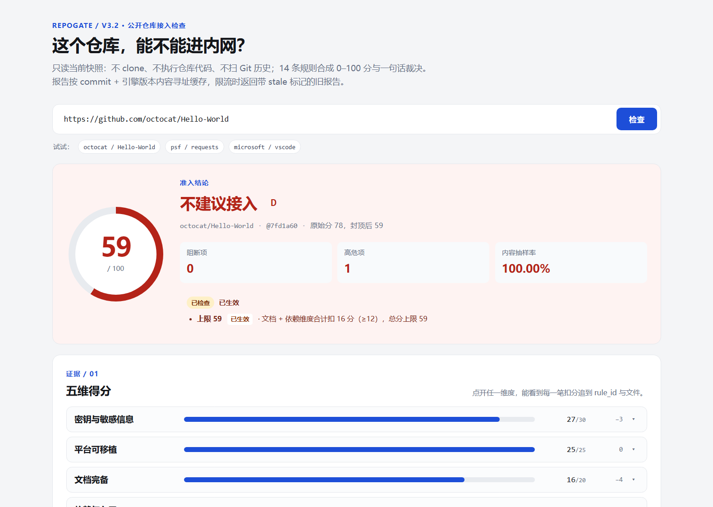
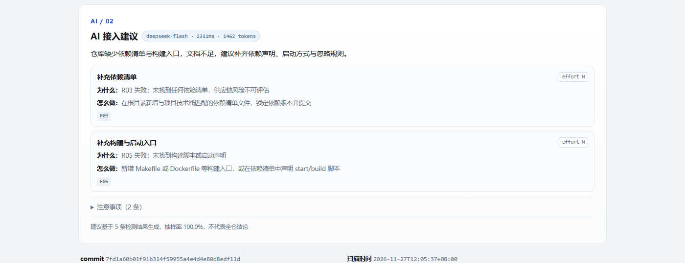
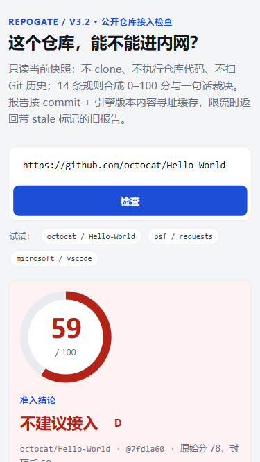
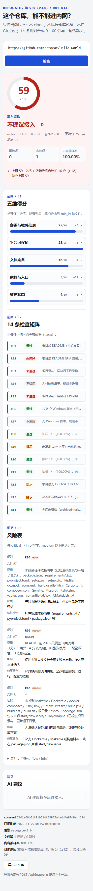
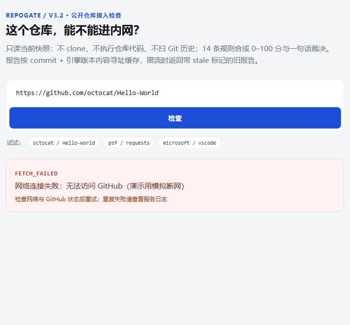
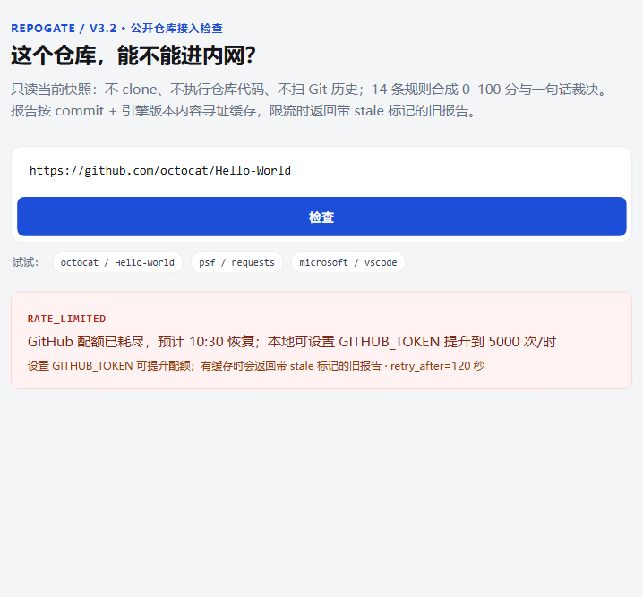
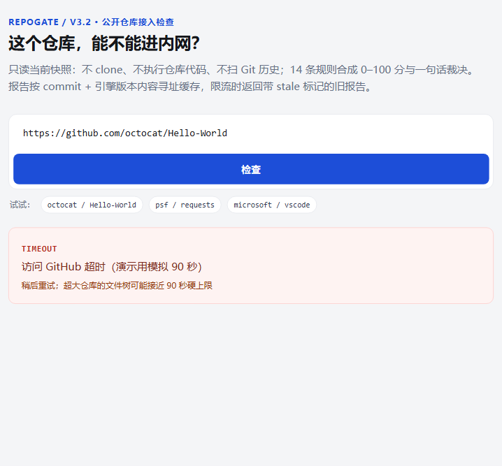

# RepoGate

**给企业内网做「公开仓库接入决策」的小工具：输入一个 GitHub 仓库地址，输出 0–100 分、A/B/C/D 等级、一句话准入裁决，以及可执行的整改建议。它不是一个通用扫描器，也不试图替代安全审计。**

仓库：<https://github.com/klxlx/repogate> · 引擎 `repogate-3.2` · 14 条规则 · MIT License



```powershell
git clone https://github.com/klxlx/repogate.git
cd repogate
python -m venv .venv && .venv\Scripts\python.exe -m pip install -r requirements.txt
.venv\Scripts\python.exe -m uvicorn app.main:app --reload
```

打开 <http://127.0.0.1:8000>。不配置模型也能跑；配置 `LLM_BASE_URL` / `LLM_API_KEY` / `LLM_MODEL` 后，报告页会多一张真实模型生成的 AI 建议卡（无模型时明确标注“规则生成”，不冒充 AI）。

## 1. 这是什么 / 解决什么问题

接入一个开源仓库前，团队真正要回答的不是「它有没有漏洞」，而是三个更具体的问题：

1. **能不能进内网**：密钥、私钥、令牌、依赖入口、文档、可移植性、维护状态，哪些是阻断项？
2. **如果不能，先改什么**：按风险等级给出 1–3 条可执行动作，而不是一长串扫描告警。
3. **结论是否可复核**：每条扣分能追到 `rule_id` 和文件；抽样率、封顶原因、缓存状态都在页面上。

RepoGate 的取舍是：**只读当前快照，不 clone、不执行仓库代码、不扫 Git 历史**。它把“接入决策”做成一个可重复的评分过程：14 条规则 → 五维扣分 → 封顶 → 等级/裁决。模型只负责把结构化事实写成建议，**不参与打分**；没有模型时规则 fallback 仍然可用。

适合：Windows 桌面/内网团队在引入 Python、Node、Go、.NET 项目前做一次快速准入。不适合：正式安全审计、漏洞利用验证、私有仓库、Git 历史取证、自动改代码。

## 2. 四步跑起来

Windows（PowerShell 7）：

```powershell
git clone https://github.com/klxlx/repogate.git
cd repogate
python -m venv .venv && .venv\Scripts\python.exe -m pip install -r requirements.txt
.venv\Scripts\python.exe -m uvicorn app.main:app --reload
```

Linux / macOS：

```bash
git clone https://github.com/klxlx/repogate.git
cd repogate
python3 -m venv .venv && .venv/bin/pip install -r requirements.txt
.venv/bin/python -m uvicorn app.main:app --reload
```

要求 Python 3.13.x；本项目在 3.13.18 上验证。首次扫描不需要 `GITHUB_TOKEN`（匿名 60 次/时）；批量使用建议设置 `GITHUB_TOKEN`，只读公开仓库即可。

可选真实模型（OpenAI 兼容）：

```powershell
Copy-Item .env.example .env
# 编辑 .env，填入 LLM_BASE_URL / LLM_API_KEY / LLM_MODEL
```

不配置时 `/api/advice` 返回 HTTP 200 的规则 fallback，页面角标显示「未配置模型」。

## 3. 截图

桌面报告页（结论 / 证据 / 建议 / AI 四卡）：


真实模型 AI 卡（DeepSeek `deepseek-flash`，多次调用 2.2–2.9s，约 1.4k tokens）：



无模型规则卡与 375px 报告页：




首页示例按钮、加载骨架和非法 URL 提示：




错误态三张（断网 / 429 / 超时，均不是白屏）：





报告页可直接用 `GET /?repo=<仓库地址>` 打开，便于把结论原样发给同事；页面上的「重新扫描」按钮等价于 `refresh=1`，会跳过缓存并消耗一次 GitHub API 配额。模型建议走单独缓存（sha + model + prompt 版本），重复打开不会重复计费。

## 4. 评分模型

**五维权重**（满分 100）：

| 维度 | key | 权重 | 主要规则 |
| --- | --- | ---: | --- |
| 密钥与敏感信息 | `secrets` | 30 | R09 / R10 / R11 |
| 平台可移植 | `portability` | 25 | R06 / R07 / R08 |
| 文档完备 | `docs` | 20 | R01 / R02 |
| 依赖与入口 | `deps` | 15 | R03 / R04 / R05 |
| 维护状态 | `maintenance` | 10 | R12 / R13 / R14 |

维度分 = `max(0, 权重 − 该维度所有 finding 扣分合计)`；`raw_total` = 五维相加；最后按门槛表取最严上限。

**扣分映射**：R01–R08 使用固定规则分；R09–R14 由 `severity` 决定：

| severity | critical | high | medium | low | info |
| --- | ---: | ---: | ---: | ---: | ---: |
| 扣分 | -30 | -15 | -10 | -3 | 0 |

例外：R09/R10/R11 命中 `tests/ test/ fixtures/ examples/ docs/ samples/ testdata/` 等测试/样例目录且为 low 时，按 0 分处理，只提示、不扣分。

**封顶（按顺序取最严）**：

| 触发条件 | 上限 | 等级 |
| --- | ---: | --- |
| R10 / R11 存在 `critical` 且 `cap_eligible=true` | 59 | D |
| R09 存在 `critical`（真实值入库） | 69 | C |
| R09 存在 `medium`（占位值 / `.env` 被提交） | 79 | B |
| `docs + deps` 维度扣分合计 ≥ 12 | 59 | D |
| `docs + deps` 维度扣分合计 8–11 | 69 | C |

**等级与裁决**：

| 总分 | 等级 | 裁决 |
| ---: | --- | --- |
| ≥ 85 | A | 可直接接入 |
| 70–84 | B | 小修后接入 |
| 60–69 | C | 需整改 |
| < 60 | D | 不建议接入 |

R07（缺跨平台入口）不设门槛：委托方本来就在 Windows 上跑，缺 `.sh` 是迁移成本，不是阻断项。这是明确的产品判断。

## 5. 14 条规则表

| id | 维度 | 判定（简短） | 分值 | 依据字段/代码 |
| --- | --- | --- | ---: | --- |
| R01 | docs | 最高可用层级无 README | -10 | `app/rules/docs.py` |
| R02 | docs | README 前 20KB 覆盖 <2 类（安装/运行/配置/依赖） | -4 | `app/rules/docs.py` |
| R03 | deps | 最高可用层级无依赖清单 | -8 | `app/rules/deps.py` |
| R04 | deps | 无 lockfile 且浮动版本 >50% | -2 | `app/rules/deps.py` |
| R05 | deps | 无构建/启动入口（scripts.start/dev/serve/build/compile、Makefile、Dockerfile 等） | -4 | `app/rules/deps.py` |
| R06 | portability | Windows 专用脚本数量与占比 | -6 | `app/rules/portability.py` |
| R07 | portability | 有 Windows 脚本但无跨平台入口 | -4 | `app/rules/portability.py` |
| R08 | portability | 硬编码盘符 / UNC / 本机绝对路径；单规则封顶 -10 | -10 | `app/rules/portability.py` |
| R09 | secrets | `.env` 入库（真实值 critical / 占位 medium / 仅缺 `.gitignore` low） | -10 | `app/rules/secrets.py` |
| R10 | secrets | 私钥材料（内容命中 critical / 仅文件名 high） | -15 | `app/rules/secrets.py` |
| R11 | secrets | 令牌形态（OpenAI/AWS/GitHub/Slack/Google/JWT/Bearer/账密 URL） | -15 | `app/rules/secrets.py` |
| R12 | maintenance | 根目录无 LICENSE 且 GitHub 元信息可判定 | -3 | `app/rules/maintenance.py` |
| R13 | maintenance | `pushed_at` 距今 >365 天 | -3 | `app/rules/maintenance.py` |
| R14 | maintenance | 仓库已归档 | -3 | `app/rules/maintenance.py` |

完整判定口径、证据层级和 `pass / fail / degraded / n/a` 四态见 `app/rules/` 与 `tests/`；`GET /api/rules` 返回同一份注册表。所有 evidence 经 `app/masking.py` 掩码，完整密钥不出现在响应、页面、日志或 golden 文件。

## 6. 更新跟踪设计（四问四答）

**Q1：怎么发现上游更新？**

`app/main.py::_inspect` 每次先读最新缓存报告里的 `repo.default_branch`，再调用 `app/github.py::resolve_head(repo_url, branch=...)`。HEAD 优先走免配额 `https://github.com/{owner}/{repo}/commits/{branch}.atom`；atom 404/解析失败时回落到 `repos/{owner}/{repo}` 元信息，再重试 atom；如果当前网络连 `github.com` 的 atom 都不可达，则再用 `repos/{owner}/{repo}/commits/{branch}` 拿 SHA。没有轮询、没有 webhook，也不靠 `pushed_at` 猜。

**Q2：怎么避免全量重算？**

缓存 key 是 `owner/repo@commit_sha@engine_version`，文件路径：

```text
.cache/reports/<owner>__<repo>/<engine_version>__<sha>.json
```

`app/cache.py` 原子写（tmp + `os.replace`）；`cache.load(..., engine_version=ENGINE_VERSION)` 只在引擎版本一致时算 hit。版本不一致不按 hit；限流兜底时作为 stale 返回，并在 `warnings[0].message` 明确写「缓存来自引擎 X，当前为 Y」。命中时不再请求 tree、不再读 raw 内容；atom 可用时 0 次 API，当前网络 atom 不可达时回退 commits API 1 次。

**Q3：报告怎么标注 commit？**

`commit.sha` 保留原报告 commit；页脚显示完整 SHA、扫描时间、`scan.engine_version`、`schema_version`、缓存状态（命中/新扫/陈旧）和缓存时间。同一 commit 的 `score / checks / findings` 可逐字节复用，旧报告不会被悄悄改成新 HEAD。

**Q4：限流失败怎么兜底？**

`app/main.py` 捕获 `ScanError.code == "RATE_LIMITED"`：

- 有任意缓存（旧 sha / 旧引擎版本）→ `cache.load_latest` 返回 HTTP 200；`cache.stale=true`、`cache.hit=false`，`warnings=[STALE_CACHE]`，页面顶部黄条提示缓存时间和原 commit，报告不隐藏。
- 无缓存 → 429，`error={code,message,hint,retry_after}`，`retry_after` 来自 `X-RateLimit-Reset` 剩余秒数；页面显示错误与恢复建议，不返回白屏。

## 7. 同类工具对比

| 维度 | OpenSSF Scorecard | repolinter | gitleaks | repoc | RepoGate |
| --- | --- | --- | --- | --- | --- |
| 主要目标 | 开源项目安全健康度评分 | 仓库结构与规范 lint | 密钥/令牌泄露扫描 | clone 前仓库信任与安全信号 | **内网接入决策** |
| Windows 接入视角 | 否 | 否 | 否 | 不是重点 | **R06/R07/R08 + Windows-only 入口注脚** |
| 决策语义 | 分项分数，偏安全健康 | 规则通过/失败 | 命中/未命中，偏取证 | trust/stack/security 信号，可 JSON | **五维加权 + 封顶 + A/B/C/D + 一句话裁决** |
| 误报治理 | 依赖上游规则 | 规则可配置 | baseline/allowlist，仍需人工复核 | 规则与启发式 | **测试目录降级、掩码、抽样率、confidence、R11 规则定义豁免收窄** |
| 可被 Agent 调用 | JSON/API 生态 | 有限 | JSON/SARIF | CLI JSON | **固定 `schema_version` 的 JSON API，含 cache/warnings/fallback** |
| 不做什么 | 不做内网准入 | 不做评分裁决 | 不做全仓接入结论 | 不做 Windows 可移植性专门评分 | 不做安全审计、漏洞利用、自动改代码 |

差异不是“谁更强”，而是问题不同：Scorecard 回答“项目安全实践做得怎么样”，gitleaks 回答“有没有泄露”，repoc 回答“能不能信任这个仓库”，RepoGate 回答“**我们这种 Windows 内网团队今天能不能接、接之前先改哪三件事**”。

## 8. 已知限制

1. **抽样率低时结论不代表全仓**：R08/R10/R11 受文本抽样约束；页面和 JSON 必须显示 `secret_sampling_ratio`，低抽样只作提示、不封顶。
2. **小写 `c:\` 已补对照用例，但以转义字符开头的路径仍会漏**：早期 `(?i)` 写法自相矛盾；3.2 改为 `[A-Za-z]` 并加小写 `c:\` 测试。R08 仍是启发式，`s:\next` 这类转义前缀和非标准盘符写法可能漏；发现漏报应补测试再改规则，不能靠调权重掩盖。
3. **`tests` 目录敏感命中只提示**：`tests/ test/ fixtures/ examples/ docs/ samples/ testdata/` 中的 `.env`、私钥、令牌按 low/info 处理，避免把假密钥夹具当事故；这也意味着测试目录里的真实泄露可能被低估。
4. **R11 规则定义豁免依赖关键字**：路径含 `rules/ patterns/` 或文件名 `gitleaks.toml` / `*rule*`，或同时含元字符与 `regex/pattern/re.compile` 才降级；普通配置字典可能漏判。
5. **未做真实并发压测**：当前只验证单进程、单仓库扫描和缓存热命中；没有证明多用户并发、超大仓库并发下的延迟与内存上限。
6. **引擎版本 3.2，规则集 14 条**：口径是 Windows 接入场景，不覆盖 CVE、Git 历史、二进制、恶意安装脚本执行。
7. **atom 不可达时并非“零 API 命中”**：正常网络下缓存命中只发 atom；当前环境 `github.com` atom 连接超时，实际回退到 `meta + commits`（首次扫描 3 次 API），这是网络现实，不是设计目标。
8. **模型建议不是审计结论**：模型只看白名单结构化事实，输出过 schema 校验；失败会回退规则并标注 `fallback_reason`，不伪造 AI 结论。

## 9. 未来工作

- **webhook / 定时重扫**：仓库 push 后自动重扫，保留 commit 历史对比，而不是每次打开页面才解析 HEAD。
- **多仓对比**：同一组织下 5–20 个候选仓库并排比较分数、阻断项和整改成本，输出接入顺序。
- **组织看板**：按团队/业务线聚合 A/B/C/D 分布、常见阻断规则和缓存命中率；仍不做多用户权限和数据库，先把单机文件缓存做稳。

## 附录：接口与缓存

| 入口 | 说明 |
| --- | --- |
| `GET /api/inspect?repo=<url>&refresh=0\|1` | 查询参数版；`refresh=1` 跳过缓存。 |
| `POST /api/inspect` | JSON `{"repo_url":"https://github.com/owner/repo"}`；兼容 `url` 字段。 |
| `POST /api/advice` | JSON `{"repo":"...","refresh":0}`；无模型也返回 200，`source="rules_fallback"`。 |
| `GET /api/health` | `engine_version / schema_version / rules_count`。 |
| `GET /api/rules` | 14 条规则注册表。 |
| `GET /docs` / `GET /redoc` | FastAPI 自动文档。 |

`InspectResponse` 顶层字段：`schema_version / repo / commit / scan / scope / stats / checks / findings / score / cache / warnings / error`。`score` 含 `total / raw_total / grade / verdict / caps / dimensions / deductions`。失败响应统一为 `{"schema_version":1,"ok":false,"error":{code,message,hint,retry_after}}`；错误码只有 `INVALID_URL / REPO_NOT_FOUND / RATE_LIMITED / FETCH_FAILED / TIMEOUT / INTERNAL`。

advice 缓存：`.cache/advice/<owner>__<repo>/<sha>__<model>__advice-v2.json`；无模型时 model 段为 `rules`。`LLM_DISABLE_THINKING=1` 用于 DeepSeek V4：默认推理会吃满 600 token 预算，关闭 thinking 后 content 才稳定返回 JSON。

## 测试

```powershell
.venv\Scripts\python.exe -m pytest -q
```

当前 `165 passed, 1 skipped`（2026-11-27，引擎 3.2）。六仓 golden 与评分 golden 的刷新命令在 `scripts/regen_golden.py` / `tests/test_six_repos_golden.py`；联网 golden 默认 skip，设置 `REPOGATE_GOLDEN_NETWORK=1` 才跑。

## 交付记录

- 六仓（引擎 3.2）：octocat `59 D`、requests `95 A`、PowerToys `84 B`、vscode `91 A`、gitleaks `98 A`、full-stack `73 B`；明细见 `docs/six-repos-3.2.md`。
- 自跑 `klxlx/repogate`：`94 A`，`R12` 根目录 `LICENSE` 判定 `pass`；缓存命中 `hit=true, stale=false`；原始响应见 `docs/self-scan.json`。其中唯一的 `R08 high` 命中 `app/rules/portability.py:33`——那是 R08 自己正则里的 `C:\foo` 模式文本，不是真实硬编码路径；与 R11 的规则定义豁免同类，R08 尚未加同款豁免，已记入已知限制，不靠调权重掩盖。
- 真实模型：DeepSeek `deepseek-flash` 已跑通（`source=model`，latency 2.2–2.9s、约 1.4k tokens）；原始 JSON 见 `docs/real-model-advice.json`，卡面截图见 `docs/screenshot-ai-deepseek.png`。
- 错误态截图：`docs/screenshot-error-offline.png`、`docs/screenshot-error-429.png`、`docs/screenshot-error-timeout.png`。
- AI 使用记录与机制总结：`AI_USAGE.md`。
